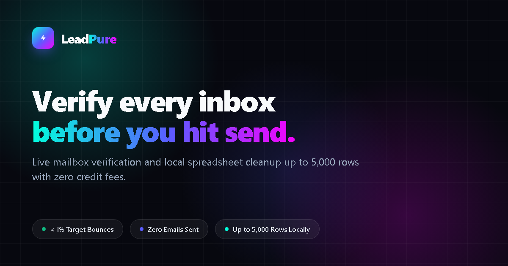
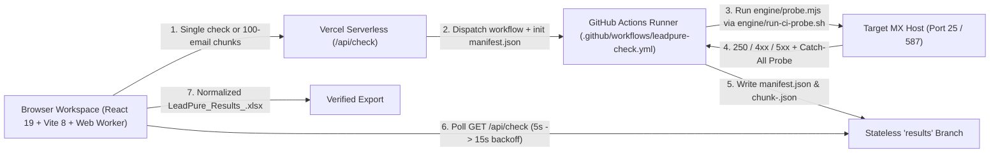

<div align="center">
  <a href="https://leadpureai.vercel.app/">
    
  </a>

  <br />

  <h1>LeadPure</h1>
  <p>
    <strong>Real-time inbox verification and browser-local spreadsheet cleaning before you hit send.</strong><br />
    Zero per-credit SaaS fees. Zero emails sent to your contacts. Honest deliverability verdicts straight from live checks.
  </p>

  <p>
    <a href="https://leadpureai.vercel.app/">
      
    </a>
    <a href="https://github.com/ossamamehmood/LeadPure-AI/actions/workflows/ci.yml">
      
    </a>
    
    
    
  </p>

  <p>
    <a href="https://leadpureai.vercel.app/">Overview</a> &bull;
    <a href="https://leadpureai.vercel.app/dashboard">Open Workspace</a> &bull;
    <a href="https://leadpureai.vercel.app/deliverability">Deliverability Guide</a> &bull;
    <a href="https://leadpureai.vercel.app/pricing">Plans</a> &bull;
    <a href="./SECURITY.md">Security</a>
  </p>
</div>

---

> [!NOTE]
> LeadPure never uses invented confidence numbers or unrealistic *"0% bounce"* promises. Every verdict (`SAFE`, `RISKY`, `INVALID`, `UNKNOWN`) comes directly from live DNS, MX, catch-all, and mail server responses without ever delivering a message to your contact.

## Why LeadPure

Most verifiers charge per-credit recurring fees, store full uploaded spreadsheets on external servers, or mark uncertain corporate firewalls as dead on the first reply. LeadPure solves both the engine and workspace layers cleanly:

| Capability | How LeadPure Works |
| :--- | :--- |
| **Live Mailbox Verification** | Zero-dependency Node.js probe (`engine/probe.mjs`) runs `EHLO` -> `MAIL FROM` -> `RCPT TO` on ephemeral GitHub Actions Port-25 runners without sending mail. |
| **2-Pass Rejection Safeguard** | Re-checks dropped connections and initial strict replies from a secondary route (plus 30s greylist wait retries) so valid buyers are not discarded. |
| **Honest Risk Isolation** | Detects catch-all domains, disposable mailboxes, role accounts (`info@`, `support@`), and forwarding providers (`ImprovMX`, `ForwardEmail`, `Cloudflare Email Routing`). |
| **Browser-Local Privacy & Hygiene** | Spreadsheets up to **5,000 rows** parse in a local Web Worker (`src/workers/xlsxWorker.ts`). Names, phones, and custom columns stay strictly in your browser (`Title Case` + E.164 phone cleanup). |
| **Chunked Execution & Resume** | Automatically splits bulk scans into **100-email chunks** (max 3 concurrent runs, 4 workers per runner) with `5s -> 15s` polling backoff and `localStorage` resume recovery. |
| **Clean Excel Exports** | Exports `LeadPure_Results_<YYYY-MM-DD>.xlsx` across `All`, `Safe`, or `Filtered` views directly from verified results. |

---

## System Architecture



> [!IMPORTANT]
> The `results` branch is an intentional, automated temporary store written by `engine/run-ci-probe.sh` and skipped by Vercel deployments (`vercel.json`: `deploymentEnabled.results = false`). Temporary result artifacts older than **7 days** are automatically purged weekly by `.github/workflows/cleanup-results.yml`.

---

## Honest Verdict Taxonomy

Verdicts remain 100% consistent across the Instant Checker UI, Bulk Workspace, summary metrics, and downloaded `.xlsx` spreadsheets:

| Verdict | Tone | Signal | Recommended Action |
| :--- | :--- | :--- | :--- |
| **SAFE** | Green | Active MX records, mailbox accepted (`250`), non-disposable, non-catch-all. | Safe for primary campaigns |
| **RISKY** | Amber | Catch-all domain, temporary greylist, role account, or forwarding provider where inbox ownership cannot be isolated. | Segment or review separately |
| **INVALID** | Rose | Syntax error, missing domain/MX (`NXDOMAIN`), disposable provider, or explicit `550` user unknown rejection. | Suppress before sending |
| **UNKNOWN** | Slate | Port-25 transient block, rate limit, or timeout after retry passes without a decisive answer. | Hold and re-verify later |

---

## API Reference

> [!NOTE]
> Legacy `/api/validate-batch` is retired (`HTTP 410 Gone`). Both single-email verification and chunked bulk spreadsheets use `/api/check`.

<details>
<summary><strong>POST /api/check - Single &amp; Bulk Verification Dispatch</strong></summary>

Single address check:

```json
{
  "email": "sales@company.example"
}
```

Bulk batch check (auto-split cleanly into 100-email chunks, up to 5,000 leads per upload):

```json
{
  "emails": [
    "alex@company.example",
    "partners@agency.example"
  ]
}
```

</details>

<details>
<summary><strong>GET /api/check?requestId=... - Manifest &amp; Chunk Polling</strong></summary>

Returns manifest progress, finished chunks, and per-email verification metadata strictly from the isolated `results` branch (`results/<requestId>/manifest.json` and `chunk-<n>.json`).

</details>

---

## Local Setup & Deployment

### Environment Variables

Configure the following variables on Vercel (or in `.env` for local `tsx server.ts` development):

| Variable | Required | Description |
| :--- | :---: | :--- |
| `LEADPURE_GH_TOKEN` | Yes | GitHub Classic PAT with `repo` and `workflow` scopes to dispatch Port-25 jobs and read the `results` branch (`REACHER_GH_TOKEN` supported as legacy fallback). |
| `LEADPURE_REPO_OWNER` | Optional | GitHub owner override (defaults to `ossamamehmood`). |
| `LEADPURE_REPO_NAME` | Optional | GitHub repository override (defaults to `LeadPure-AI`). |

### Development Commands

```bash
# Install dependencies
npm install

# Start Vite frontend + Express dev backend locally
npm run dev

# Static checks, engine verification tests, determinism check & production build
npm run lint
npm test
npm run test-engine
npm run build
```

---

## Repository Layout

```text
LeadPure-AI/
├── api/
│   ├── check.ts                   # Single & chunked bulk orchestration + manifest reader
│   └── validate-batch.ts          # Retired HTTP 410 stub
├── engine/
│   ├── probe.mjs                  # Zero-dependency Node.js SMTP / DNS / catch-all engine
│   └── run-ci-probe.sh            # GitHub Actions runner entrypoint & results publisher
├── src/
│   ├── components/                # Responsive Dark/Light UI, landing pages, workspace & liquid glass
│   ├── hooks/                     # Bulk scan queue, backoff polling, history persistence
│   ├── lib/                       # Syntax/disposable/role rules & .xlsx exporter
│   ├── utils/                     # Local contact normalization (Title Case, E.164 phone)
│   └── workers/xlsxWorker.ts      # Off-main-thread Excel/CSV parser (up to 5,000 rows)
├── backend/                       # Optional self-hosted Port-25 Docker/Express daemon
├── public/                        # robots.txt, sitemap.xml, llms.txt, site.webmanifest, OG & PWA icons
├── agents/                        # Engineering rules, architecture notes & audit protocols
├── vercel.json                    # Security headers, cache rules & SPA rewrites
└── .github/
    ├── dependabot.yml             # Dependency update schedule
    └── workflows/
        ├── ci.yml                 # Lint, static guards, test suite & Vite build
        ├── leadpure-check.yml     # Port-25 workflow dispatcher with Port-25 gate & retries
        └── cleanup-results.yml    # Weekly Sunday cron pruning results > 7 days
```

---

## Security, Privacy & Support

- **Security Policy:** See [SECURITY.md](./SECURITY.md) for data-flow boundaries, input sanitization, HSTS/security headers, and private disclosure steps.
- **Audit Ledger:** See [AUDIT_V14.md](./AUDIT_V14.md) for historical defect resolution and determinism verification records.
- **Optional Dedicated SMTP Node:** See [backend/README.md](./backend/README.md) if hosting your own Port-25 Docker service instead of GitHub Actions runners.
- **Support Development:** [Patreon](https://www.patreon.com/c/ossamamehmood) &bull; Built by [Ossama Mahmood](https://ossamamehmood.com)
