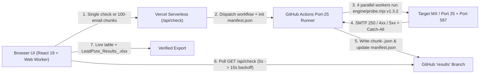

<div align="center">
  <a href="https://leadpureai.vercel.app/">
    
  </a>

  <br /><br />

  <h1>LeadPure AI: Precision SMTP Verification Engine</h1>
  <p>
    <strong>Serverless single &amp; chunked-bulk email verification powered by Own SMTP Engine 1.3.2.</strong><br />
    Zero external verification SaaS APIs. Zero fabricated confidence scores. Honest verdicts straight from live Port-25 handshakes.
  </p>

  <p>
    <a href="https://leadpureai.vercel.app/"></a>
    
    
    
    
  </p>
</div>

---

## Overview

**LeadPure AI V14** validates email addresses at scale using a custom zero-dependency Node.js SMTP probe (`engine/probe.mjs` v1.3.2) running on ephemeral GitHub Actions Port-25 runners, orchestrated by a React 19 + Vercel Serverless web app.

Instead of relying on proprietary third-party verification APIs or returning optimistic fallback guesses when a mail server stalls, every check executes a multi-stage DNS + live SMTP conversation (`EHLO` -> `MAIL FROM` -> `RCPT TO`) with explicit catch-all, greylist, and forwarding-provider detection.

### Key Capabilities

| Capability | Details |
| :--- | :--- |
| **Own SMTP Engine `1.3.2`** | Pure Node.js (`net`, `dns`, `tls`) Port-25 verifier with 2-pass retry on dropped connections, 30s greylist wait & retry, and catch-all probing. |
| **Forwarding Provider Aware** | Recognizes `ImprovMX`, `ForwardEmail`, and `Cloudflare Email Routing` MX patterns so valid aliases are not falsely rejected. |
| **5,000-Lead Chunked Scale** | Client-side Web Worker parses spreadsheets without freezing the UI, splits lists into **100-email chunks** (max **3** concurrent Actions runs), and runs **4 parallel workers** per runner. |
| **Resumable Manifest Polling** | Tracks jobs via `results/<requestId>/manifest.json` + `chunk-<n>.json` with `5s -> 15s` polling backoff (20-minute cap) and `localStorage` scan resume (`leadpure_last_scan_v14`). |
| **Honest Verdict Reporting** | No arbitrary percentage scores or *"0% bounce"* promises. Summary cards display exact counts plus the run's **Definitive Rate** (`(SAFE + RISKY + INVALID) / arrived`). |
| **Exact `.xlsx` Export** | Downloads `LeadPure_Results_<YYYY-MM-DD>.xlsx` containing strictly the arrived verdicts (`All`, `SAFE Only`, or `Filtered` view). |

---

## Architecture



---

## Honest Verdict Taxonomy

Verdicts remain 100% consistent across the UI table, summary cards, and exported `.xlsx` spreadsheets:

| Verdict | Badge | Meaning | Recommended Action |
| :--- | :--- | :--- | :--- |
| **SAFE** | Green | MX resolves, SMTP `RCPT TO` accepted (`250`), mailbox verified active, and domain is not a catch-all. | Ready for outreach |
| **RISKY** | Amber | Catch-all domain, temporary greylist / soft limit, role address, disposable domain, or forwarding provider where final inbox existence cannot be proven. | Segment or send cautiously |
| **INVALID** | Red | Syntax invalid, domain/MX does not exist (`NXDOMAIN`), or target MX explicitly rejected the mailbox (`550` / user unknown). | Suppress / remove from list |
| **UNKNOWN** | Grey | Transient network block, Port-25 timeout across retries, or unfinished chunk timed out before final engine response. | Re-run when target MX clears |

---

## API Reference

> **Note:** Legacy `/api/validate-batch` is deprecated (`HTTP 410`). All single and bulk orchestration goes through `/api/check`.

### Dispatch Check (`POST /api/check`)

<details>
<summary><strong>Single Email Payload</strong></summary>

```json
{
  "email": "founder@example.com"
}
```

</details>

<details>
<summary><strong>Bulk List Payload (auto-split into 100-email chunks)</strong></summary>

```json
{
  "emails": [
    "alice@example.com",
    "bob@example.com"
  ]
}
```

</details>

### Poll Status & Results (`GET /api/check?requestId=...`)

Returns manifest status, completed chunks, arrived row verdicts, and metadata read strictly from the `results` branch (`results/<requestId>/manifest.json` & `chunk-<n>.json`).

---

## Setup & Deployment

### Environment Variables

Set the following variables on Vercel (and `.env` for local backend dev):

| Variable | Required | Description |
| :--- | :--- | :--- |
| `LEADPURE_GH_TOKEN` | Yes | GitHub Classic PAT with `repo` and `workflow` scopes to trigger Port-25 runners and read `results` branch (`REACHER_GH_TOKEN` supported as fallback). |
| `LEADPURE_REPO_OWNER` | Optional | GitHub repository owner override (defaults to `ossamamehmood`). |
| `LEADPURE_REPO_NAME` | Optional | GitHub repository name override (defaults to `LeadPure-AI`). |

### Local Development

```bash
# Install dependencies
npm install

# Run local Express + Vite dev server
npm run dev

# Type-check, run engine test suite, and build production bundle
npm run lint
npm test
npm run build
```

---

## Repository Structure

```text
LeadPure-AI/
├── api/
│   ├── check.ts                 # Single & chunked bulk orchestration + manifest reader
│   └── validate-batch.ts        # Deprecated HTTP 410 stub
├── engine/
│   └── probe.mjs                # Own SMTP Engine v1.3.2 (zero external deps)
├── src/
│   ├── components/              # Responsive Dark/Light UI components (React 19)
│   ├── lib/                     # Rules engine, client helpers, XLSX export
│   └── workers/                 # Non-blocking Web Worker spreadsheet parser
├── scripts/
│   └── run-ci-probe.sh          # GitHub Actions runner entrypoint
└── .github/workflows/
    ├── leadpure-check.yml       # Port-25 verification workflow (max 3 concurrent runs)
    └── cleanup-results.yml      # Weekly Sunday cron pruning results/ older than 7 days
```

---

## Security & Automated Cleanup

- **Weekly Result Pruning:** `.github/workflows/cleanup-results.yml` automatically deletes `results/<requestId>/` folders older than **7 days** (plus supports manual cleanup via `workflow_dispatch`).
- **Full Security Details:** See [SECURITY.md](SECURITY.md) for data flow, ephemeral runner isolation, and vulnerability disclosure guidelines.
