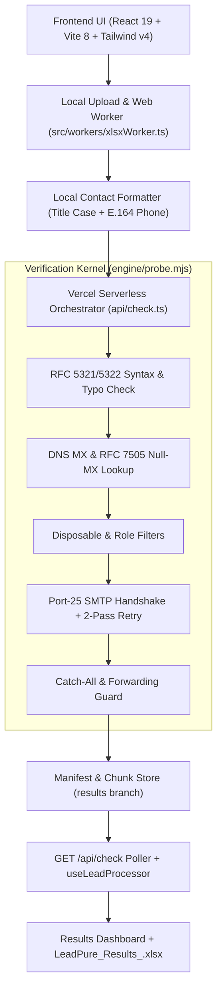

# System Architecture Blueprint

> [!NOTE]
> LeadPure follows a unidirectional, stateless pipeline combining browser-local parsing with ephemeral Port-25 execution.

---

## Data Flow

---

## Core Modules

| Layer | Technology | Responsibility |
| :--- | :--- | :--- |
| **Frontend Workspace** | React 19, Vite 8, Motion | Route-split SPA (`/` marketing, `/dashboard` workspace, `/deliverability`, `/pricing`, `/privacy`, `/terms`). |
| **Spreadsheet Worker** | `src/workers/xlsxWorker.ts` | Non-blocking `.xlsx` / `.csv` / `.xls` parsing up to **5,000 rows** locally in browser memory. |
| **API Orchestrator** | `api/check.ts` (Vercel Serverless) | Sanitizes payloads, chunks lists (`100` rows/chunk, max 3 concurrent runs), and reads `results` manifests. |
| **SMTP Probe Runner** | `engine/probe.mjs` on GitHub Actions | Pure Node.js Port-25 verifier with Azure/AWS Port-25 preflight gate and `results` commit publisher. |
